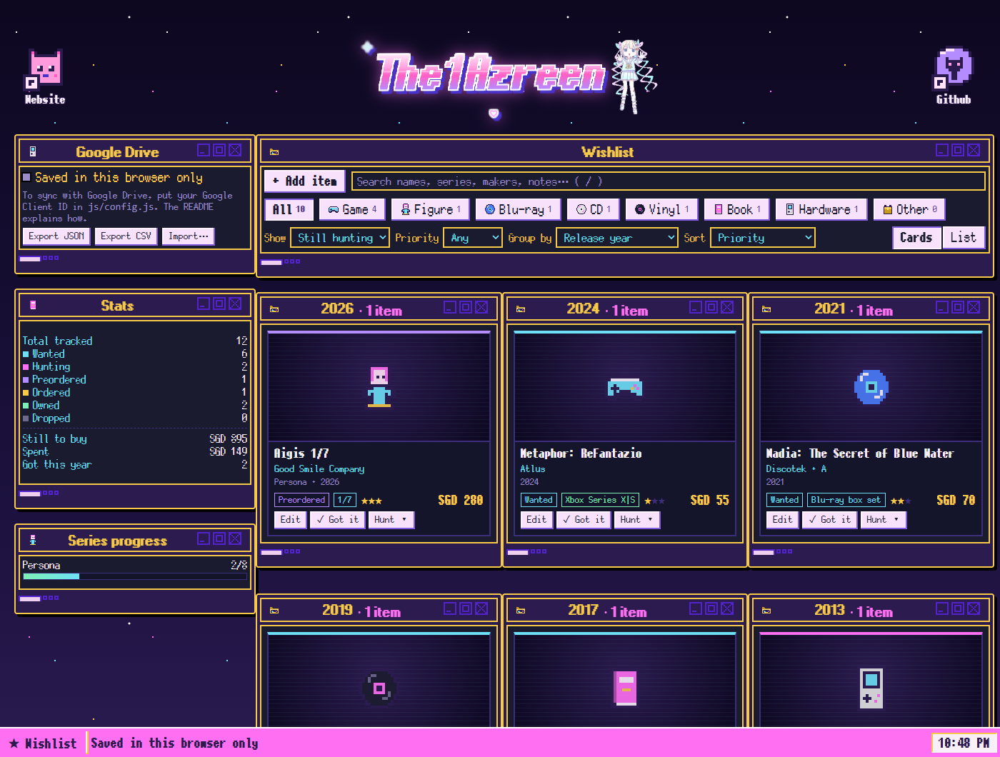
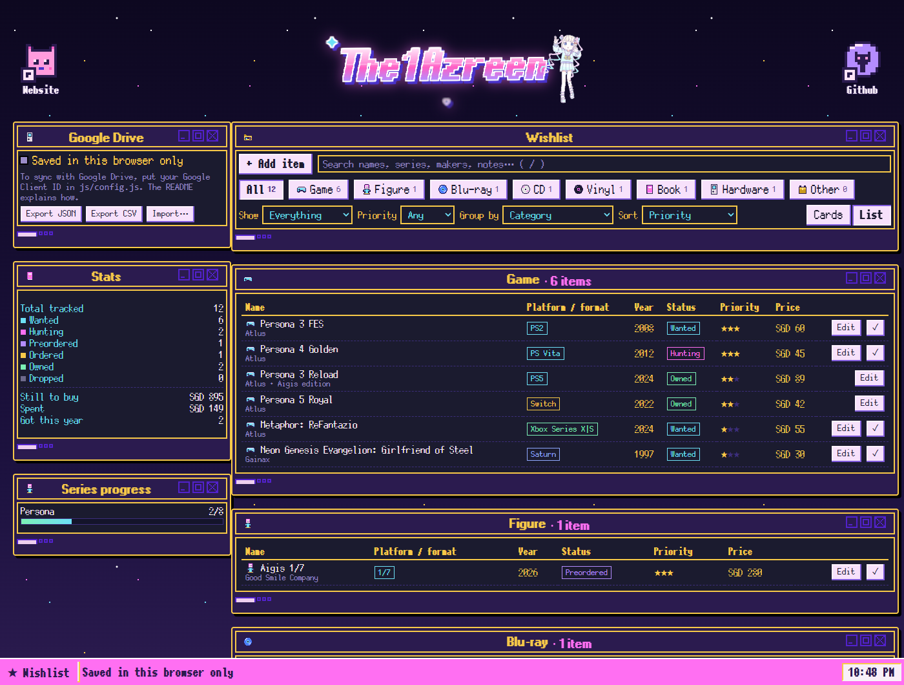
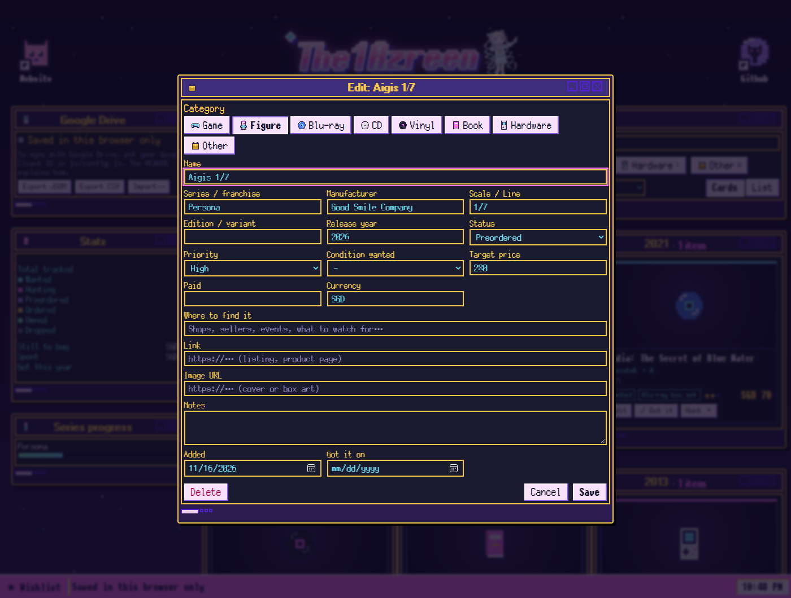

# Wishlist Tracker

A wishlist for my collection (games, figures, Blu-rays, CDs, vinyl, books, hardware and more), in the
look of [my website](https://the1azreen.neocities.org/). It syncs with a Google Sheet in my Google
Drive, so the list can be edited here, in Google Sheets, or on my phone.



<table>
  <tr>
    <td></td>
    <td></td>
  </tr>
  <tr>
    <td align="center">List view, grouped by category</td>
    <td align="center">The editor relabels its fields for each category</td>
  </tr>
</table>

It's plain HTML, CSS and JavaScript with no build step and no server. The theme files (`css/main.css`,
`css/needy.css`, `css/logo.css`, fonts, cursors and buttons) are copied from the
[Azreen-Website](https://github.com/The1Azreen/Azreen-Website) repo. `css/app.css` adds the app's own parts.

## Features

- **Types (categories):** Game, Figure, Blu-ray, CD, Vinyl, Music, Book, Hardware, Other, picked at the top
  of the editor. Each one relabels the
  fields: Platform for games, Scale / Line for figures, Artist and Pressing for music, Author and
  Language for books, and so on. Each also suggests common values.
- **Physical release by:** who put it out on disc or cartridge (Limited Run Games, Red Art Games,
  eastasiasoft…). List several with commas. Searching a name finds every item it released.
- **In print?** Mark items In print, Out of print (shown as an **OOP** chip) or Reprint. Filter by it,
  or group by it to see what is getting hard to find.
- **Statuses:** Wanted → Hunting → Preordered → Ordered → Owned (or Dropped). **✓ Got it** marks an
  item owned and records today's date.
- **Timeline:** items grouped by release year. You can also group by category, series, status or
  platform, and switch between Cards and List views.
- **Hunt ▾** on every item opens searches on sites that suit its category: PriceCharting,
  MyFigureCollection, AmiAmi, Mandarake, Discogs, Blu-ray.com, AbeBooks, eBay and Carousell.
- **Stats** (still to buy, spent, got this year) and **series progress** (for example "Persona 3/8 owned").
- Undo for deletes and "Got it", search (`/`), new item (`N`), and import/export as JSON or CSV.

## Run it locally

**Easiest:** double-click **`run.bat`**. It starts the app at <http://localhost:8000> and opens it in
your browser. Keep its window open while you use the app, and close the window to stop it. It needs
[Python](https://www.python.org/downloads/). If the app is already running, the batch file just opens
the page.

Or, from a terminal: `python serve.py`, then open <http://localhost:8000>. Use `localhost`, not
`127.0.0.1`, because Google sign-in only works on the addresses you list in step 4 below.

## Where your data is saved

Your list is never saved in the repo's tracked files, so it never shows up in commits.

| Where | When |
|---|---|
| **Google Sheet** "Wishlist Tracker" in your Drive | After you connect Google (see below). This is the main copy. |
| **`backups/` in this folder** | Automatically, whenever the app is running through `run.bat`. The folder is in `.gitignore`. |
| Your browser's storage | Always, so the page opens instantly. Each address (localhost, GitHub Pages) has its own copy. |
| Your Downloads folder | When you click **Export JSON** or **Export CSV**. |

The automatic local copy (written by [`serve.py`](serve.py)):

```
backups/
  wishlist.json                    the whole list, rewritten about 1.5 seconds after each change
  wishlist.csv                     the same list for Excel
  history/wishlist-2026-11-24.json one copy per day; the last 30 days are kept
```

The Google Drive window in the app shows when the copy was last saved. If your browser's list is ever
empty (a new PC, or cleared browser data), the app offers **Restore from local copy**. You can also load
any of these files with **Import…**. A browser that starts with an empty list can't overwrite a backup
that has items in it.

This only works through `run.bat`, because browsers can't write to your folders by themselves.
The GitHub Pages version still syncs with Google Drive and can still export. The local server only
listens on your own PC, and it refuses saves that come from any page other than the app.

## Connect Google Drive (one time, about 10 minutes)

The app signs in with your Google account and keeps the list in a Sheet called **Wishlist Tracker**
that it creates in your Drive. It asks only for the `drive.file` permission, so it can see **only
files it created itself**, and nothing else in your Drive.

1. Go to <https://console.cloud.google.com/> and create a project (for example "Wishlist Tracker").
2. **APIs & Services → Library:** enable **Google Sheets API** and **Google Drive API**.
3. **Google Auth Platform** (called "OAuth consent screen" in older menus):
   - App name "Wishlist Tracker", your email as support and developer contact, Audience **External**.
   - Under **Audience → Test users**, add your own Gmail address. Staying in "Testing" is fine for
     personal use; only the test users you list can sign in.
4. **Clients** (or **Credentials → Create credentials → OAuth client ID**):
   - Application type: **Web application**
   - Authorized JavaScript origins:
     - `http://localhost:8000` (for testing on your PC)
     - `https://the1azreen.github.io` (for GitHub Pages)
   - You don't need any redirect URIs.
5. Copy the **Client ID** (it ends in `.apps.googleusercontent.com`) into `js/config.js`:

   ```js
   googleClientId: '1234567890-abc….apps.googleusercontent.com',
   ```

   A Client ID isn't a secret. It only works on the origins listed in step 4, so it's safe to commit.

6. Open the app and click **Connect Google Drive**. Anything already saved in the browser can be
   copied into the Sheet.

Google's sign-in lasts an hour at a time. When it runs out, the app shows **Reconnect**, which is one
click with no password once you've agreed the first time.

### Editing in Google Sheets

Row 1 holds the column names. The app matches columns by **name**, so you can reorder them, sort
rows, add your own columns (the app keeps them), or type new rows by hand. A row you type gets an
`id` filled in the next time the app loads. Don't rename or clear the `id` column. Changes made in
the Sheet show up when you press **Refresh** or come back to the app's tab.

| Column | What it holds |
|---|---|
| `name`, `category`, `series` | What it is, and which set it belongs to |
| `maker`, `format`, `edition`, `region` | Publisher/Platform, Manufacturer/Scale, Artist/Format… depending on category |
| `release_year` | Used for the timeline |
| `status`, `priority`, `condition` | Wanted/Hunting/Preordered/Ordered/Owned/Dropped · High/Medium/Low · wanted condition |
| `target_price`, `paid_price`, `currency` | Numbers, plus a currency code such as SGD, JPY or USD |
| `where`, `link`, `image` | Where to look, a listing or product link, a cover image URL |
| `notes`, `added`, `acquired`, `updated` | Free text and dates |

## Publish on GitHub Pages

In the repo on GitHub: **Settings → Pages → Build and deployment → Deploy from a branch → `main` /
`(root)`**. The app will be at `https://the1azreen.github.io/Wishlist-Tracker/`. On the free plan,
GitHub Pages needs the repo to be public. That's fine: the code has nothing private in it, and the
list itself lives in your Google Sheet, not in the repo.

## Next: a read-only page on the Neocities site

Neocities blocks a page's requests to other sites, so the website can't read the Sheet live. The plan
uses the same pattern as the GitHub feed there: a step in Azreen-Website's deploy workflow downloads
the Sheet into `js/data/wishlist.json`, and `pages/wishlist.html` shows it.
